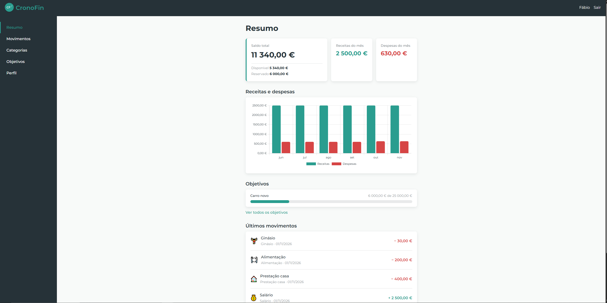

# 📈 CronoFin - Gestor de finanças pessoais

---

## 📋 Sobre o projeto

**CronoFin** é uma aplicação web que, através de uma interface simples e intuitiva, permite acompanhar e organizar as finanças pessoais para auxiliar a criação de hábitos financeiros saudáveis.

---

## 🎯 Objetivo

É um projeto de carácter pessoal e académico, desenvolvido para aprender e consolidar competências em desenvolvimento web (PHP, MySQL, HTML, CSS e JavaScript), com preocupação por boas práticas: CSS próprio dividido por ficheiros, abordagem _mobile first_, estrutura com pasta `public/`, consultas preparadas e validação no servidor.

---

## 🧑‍💻 Programador

**Fábio Guimarães**  
Web Developer

- Email: fog1991@gmail.com
- Linkedin: https://www.linkedin.com/in/fabio-guimaraes-web-dev
- GitHub: https://github.com/fabio-o-guimaraes

---



## 📑 Índice

- [Funcionalidades](#funcionalidades)
- [Tecnologias](#tecnologias)
- [Estrutura do projeto](#estrutura-do-projeto)
- [Base de dados](#base-de-dados)
- [Instalação](#instalação)
- [Primeiros passos](#primeiros-passos)
- [Segurança](#segurança)

---

## Funcionalidades

**Conta**

- Registo (nome, email, fotografia e password), login e logout.
- Área privada protegida: sem sessão iniciada, não há acesso ao dashboard.

**Resumo**

- Saldo total, com o saldo disponível e o valor reservado em objetivos.
- Receitas e despesas do mês atual.
- Gráfico de barras de receitas vs. despesas dos últimos 6 meses.
- Os objetivos ativos mais recentes (com barra de progresso) e os últimos movimentos.

**Movimentos**

- Registo de receitas e despesas, cada uma com valor, data, categoria e descrição opcional.
- Pesquisa e filtros por texto, tipo, categoria e mês.
- Edição e eliminação de movimentos.
- Paginação (20 movimentos por página), que mantém os filtros.

**Categorias**

- Cada utilizador cria e gere as suas próprias categorias, com um ícone (emoji) à escolha.
- Edição, eliminação, desativação e reativação.

**Objetivos**

- Criação de objetivos com uma meta e acompanhamento do progresso através de cards.
- Adicionar ou retirar poupança de cada objetivo.
- Alterar a meta, eliminar, marcar como adquirido, editar um objetivo adquirido e voltar a ativá-lo.

**Perfil**

- Alteração do nome, email, fotografia e password.

---

## Tecnologias

| Camada                      | Tecnologia                                                       |
| --------------------------- | ---------------------------------------------------------------- |
| Servidor                    | PHP 8.1+                                                         |
| Base de dados               | MySQL / MariaDB (InnoDB), acesso via PDO                         |
| Front-end                   | HTML5, CSS3 (sem frameworks), JavaScript                         |
| Gráficos                    | [Chart.js](https://www.chartjs.org/) (via CDN, apenas no Resumo) |
| Fonte                       | Montserrat                                                       |
| Ambiente de desenvolvimento | XAMPP                                                            |

---

## Estrutura do projeto

```
CronoFin/
├── config/            # Ligação à base de dados (PDO)
├── database/          # Script SQL de criação da base de dados
├── docs/design/       # Logos, moodboard, styleguide, sitemap, modelo ER e wireframes
├── includes/          # Código PHP partilhado e secções do dashboard
├── public/            # Raiz pública: páginas, actions/ (formulários) e assets/ (CSS, JS, imagens, uploads)
├── project_GUIDE.md   # Documento de planeamento do projeto
└── README.md

```

A árvore completa, com a descrição de cada ficheiro, está no [Guia do projeto](project_GUIDE.md)

---

## Base de dados

Cinco tabelas, todas InnoDB:

| Tabela          | Descrição                                          |
| --------------- | -------------------------------------------------- |
| `users`         | Utilizadores e dados de autenticação               |
| `categories`    | Categorias criadas por cada utilizador             |
| `movements`     | Receitas e despesas                                |
| `goals`         | Objetivos financeiros                              |
| `contributions` | Histórico do dinheiro reservado para cada objetivo |

O script de criação está em database/schema.sql. O modelo entidade-relação e as regras de negócio estão no [Guia do projeto](project_GUIDE.md)

---

## Instalação

### Requisitos

- [XAMPP](https://www.apachefriends.org/) (ou equivalente) com **PHP 8.1 ou superior**, Apache e MySQL/MariaDB.
- [Git](https://git-scm.com/) (opcional, para clonar o repositório).

### Passos

1. **Clonar o repositório** para a pasta pública do Apache (no XAMPP, `htdocs`):

   ```bash
   cd C:\xampp\htdocs
   git clone https://github.com/fabio-o-guimaraes/CronoFin.git cronofin
   ```

2. **Iniciar o Apache e o MySQL** no painel de controlo do XAMPP.

3. **Criar a base de dados:** abre o phpMyAdmin (`http://localhost/phpmyadmin`), vai ao separador **SQL** e corre o script da secção [Base de dados](#base-de-dados).

4. **Configurar a ligação:** edita o `config/database.php` com as credenciais da tua instalação (servidor, nome da base de dados `cronofin`, utilizador e password). No XAMPP, o utilizador por defeito é `root`, sem password.

5. **Verificar a pasta de uploads:** `public/assets/uploads/profiles/` tem de existir e permitir escrita, para as fotografias de perfil.

6. **(Recomendado) Definir o fuso horário** no `php.ini`, para as datas coincidirem com a hora local:

   ```ini
   date.timezone = Europe/Lisbon
   ```

7. **Abrir a aplicação:** `http://localhost/cronofin/public/`

---

## Primeiros passos

1. Cria uma conta no **Registo** e inicia sessão.
2. Em **Categorias**, cria as categorias que queres usar (por exemplo, Alimentação, Habitação ou Salário). Sem categorias, não é possível registar movimentos.
3. Em **Movimentos**, regista as tuas receitas e despesas.
4. Em **Objetivos**, define uma meta e começa a reservar dinheiro para ela. Só podes reservar o que tens disponível.
5. No **Resumo**, vê de relance o estado das tuas finanças.

---

## Segurança

- Passwords guardadas com `password_hash()` e verificadas com `password_verify()`.
- Acesso à base de dados por PDO com **consultas preparadas**.
- **Validação sempre no servidor**, mesmo quando o HTML já limita o campo (tipos, limites, listas de valores permitidos).
- Upload de fotografias com verificação do tipo real do ficheiro, limite de tamanho e nome aleatório.
- Operações que alteram várias tabelas usam transações, para gravar tudo ou nada.

---
