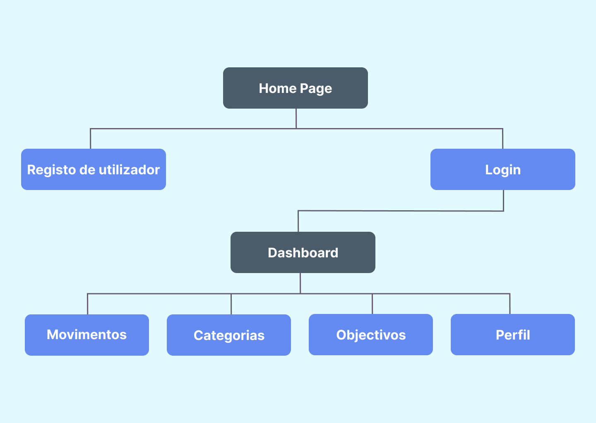
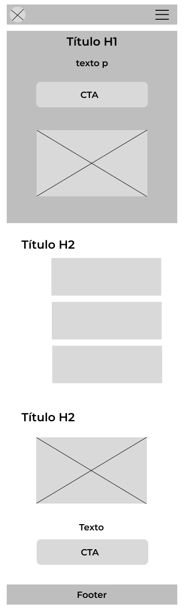
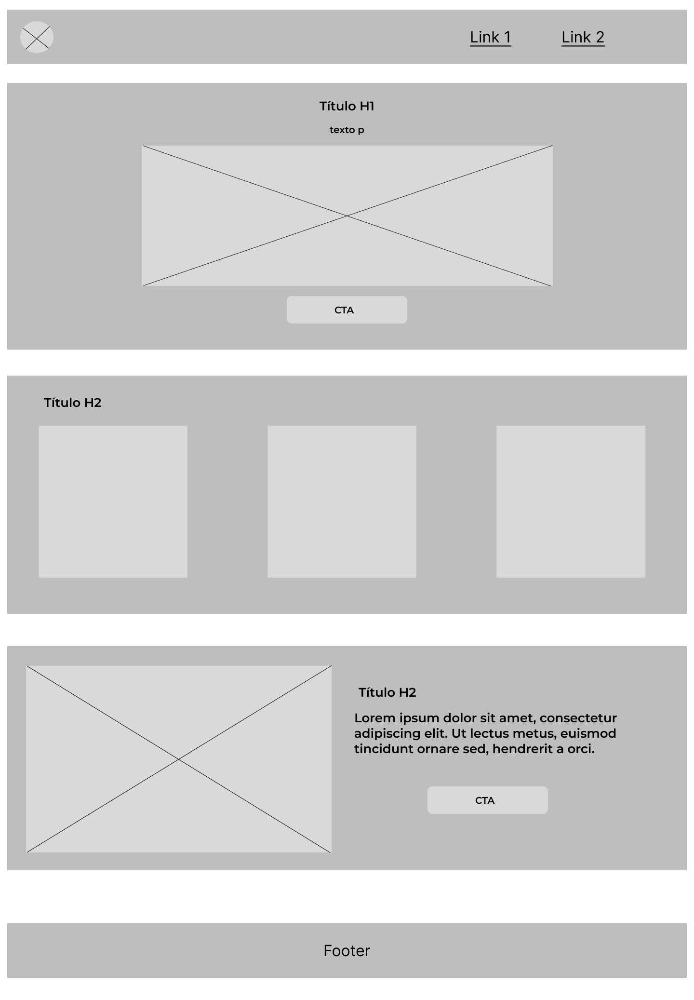
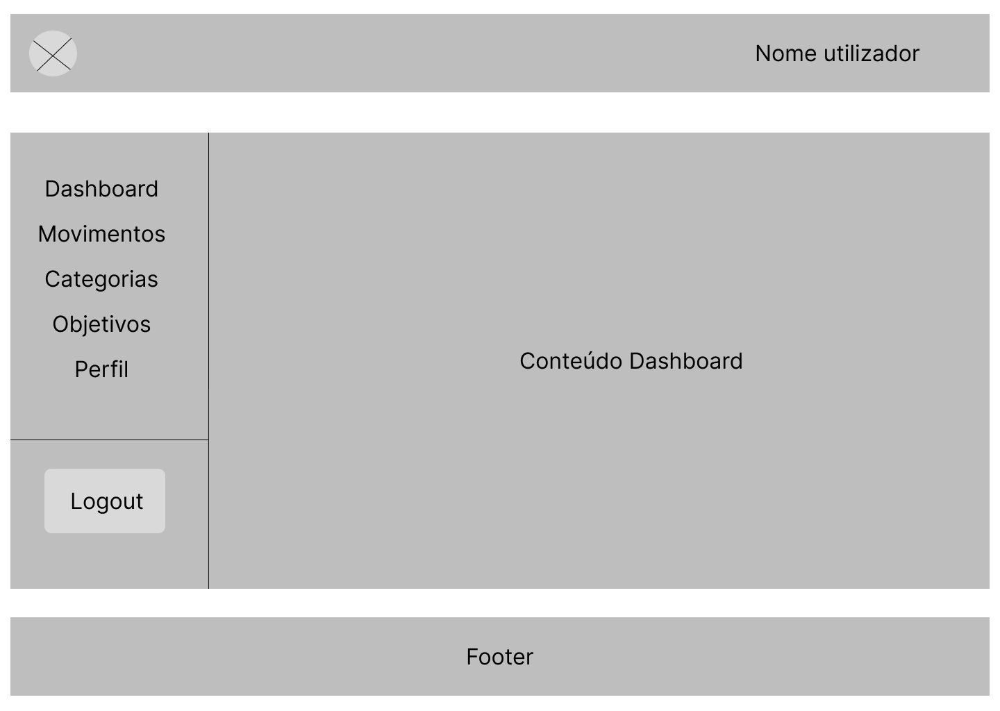
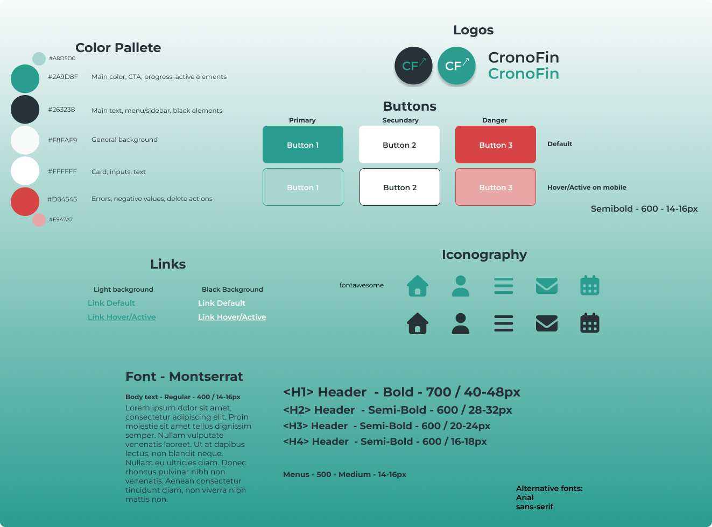
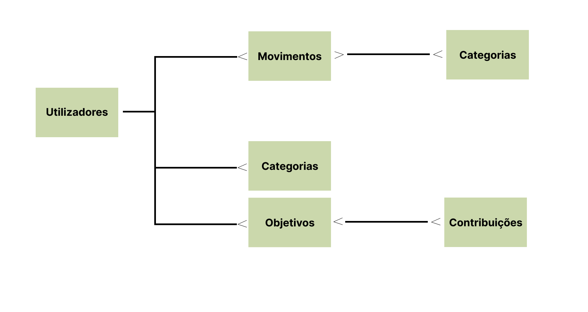
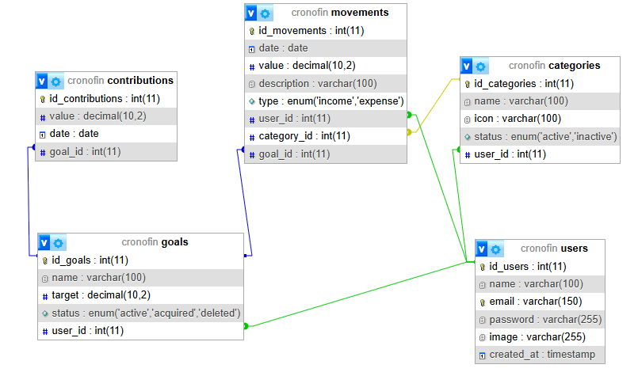

# 📋 Guia de desenvolvimento - Projeto CronoFin

---

## 🌐 Visão Geral

---

- **Tema:** Gestor de finanças pessoais
- **Nome:** CronoFin
- **Finalidade:** Projeto pessoal de desenvolvimento profissional/técnico
- **Objetivo:** Criar um projeto que permita, de forma simples, ajudar o utilizador a desenvolver hábitos financeiros saudáveis.
- **Tecnologias:** HTML, CSS, JavaScript, PHP, MySQL

---

## 🎯 Briefing

---

- **Objetivo do website:** Desenvolver uma aplicação web que permita ao utilizador gerir as suas finanças pessoais, acompanhando o dinheiro que entra e sai através de uma interface simples, intuitiva e orientada para a criação de hábitos financeiros saudáveis.

- **Público-alvo:** Adultos entre os 20 e os 45 anos que pretendem organizar as suas finanças pessoais de forma simples, sem recorrer a aplicações financeiras complexas ou folhas de cálculo.

### Necessidades

- Controlar receitas e despesas;
- Saber para onde vai o dinheiro;
- Poupar para objetivos pessoais;
- Ter uma visão simples da sua situação financeira;
- Substituir o Excel por uma aplicação mais intuitiva.

### Exemplos de utilizadores

- Jovens trabalhadores;
- Casais;
- Estudantes universitários;
- Pessoas que começaram a gerir o seu próprio dinheiro;
- Utilizadores que atualmente recorrem ao Excel.

### Princípios do projeto

- Interface simples e intuitiva;
- Poucos cliques para executar tarefas;
- Informação clara e objetiva;
- Dashboard de fácil leitura;
- Apenas funcionalidades essenciais;
- Navegação simples e consistente;
- Promover hábitos financeiros saudáveis.

### Sites de referência

| Aplicação       | Pontos fortes                                                                                                                                                                                                                     | Pontos fracos                                                                                                                                                                                                  |
| --------------- | --------------------------------------------------------------------------------------------------------------------------------------------------------------------------------------------------------------------------------- | -------------------------------------------------------------------------------------------------------------------------------------------------------------------------------------------------------------- |
| **YNAB**        | - Interface limpa, todos os elementos "respiram";<br>- Exibe a informação mais relevante imediatamente (quanto tenho, quanto posso gastar, quanto já gastei);<br>- Formulários rápidos, com poucos cliques se chega ao resultado. | - Curva de aprendizagem;<br>- Parece uma ferramenta de trabalho, fica muito séria e não transmite sensação de leveza;<br>- Muitas opções e demasiada informação, tornando a utilização menos simples e direta. |
| **Firefly III** | - Excelente estrutura/arquitetura.                                                                                                                                                                                                | - Demasiadas opções, sobretudo para novos utilizadores;<br>- Interface pesada, com muitos textos, tabelas e menus, tendo pouco espaço livre.                                                                   |

### Conclusão da análise

O projeto procurará combinar a simplicidade visual e a boa experiência de utilização do YNAB com uma arquitetura organizada, evitando, no entanto, a complexidade funcional presente em ambas as aplicações.

**O problema:** Muitas aplicações de gestão financeira apresentam um elevado nível de complexidade para utilizadores que apenas pretendem controlar as suas receitas e despesas diárias.

**A solução:** Criar uma aplicação web simples, intuitiva e rápida, que permita ao utilizador acompanhar receitas e despesas sem necessidade de aprender métodos financeiros complexos.

---

## 🗺️ Mapa do site

---



### Área pública

**Página Inicial**  
Objetivo: convencer o utilizador a experimentar a aplicação, comunicando de forma simples os seus benefícios e funcionalidades principais.

- Hero
- Benefícios
- Como funciona
- Screenshots
- Call to Action

**Registo**

**Login**

### Área privada

Restrita a utilizadores com sessão iniciada.

**Dashboard/Resumo**

- Resumo com saldo atual, receitas, despesas e valor reservado;
- Gráfico simples de receitas vs. despesas;
- Objetivos;
- Últimos movimentos.

**Movimentos**

- Adicionar movimento através de formulário;
- Pesquisa de movimentos;
- Todos os movimentos.

**Categorias**

- Adicionar;
- Editar;
- Eliminar/desativar;

**Objetivos**

- Criar novo objetivo (nome e valor/meta);
- Adicionar descrição opcional;
- Visualizar progresso através de uma barra de percentagem;
- Adicionar valores aos objetivos.

**Perfil**

- Dados pessoais;
- Alteração de password;
- Nome, email e fotografia.

**Logout**

---

## ✏️ Design/Wireframes

---

### Versão Mobile

<br>

### Versão Desktop




Foram desenvolvidos wireframes de baixa fidelidade para as duas principais áreas da aplicação: a homepage e o dashboard.

A homepage foi concebida para apresentar a aplicação ao utilizador, destacar os seus principais benefícios e incentivá-lo a criar uma conta para começar a utilizar. Na versão mobile, a principal diferença relativamente à versão desktop prende-se com a reorganização dos elementos numa disposição vertical, proporcionando uma melhor experiência de utilização em ecrãs de menor dimensão.

O dashboard foi concebido com uma estrutura semelhante à utilizada em aplicações como o Gmail, recorrendo a um menu lateral para a navegação entre as diferentes funcionalidades. Na versão desktop, este menu permanece sempre visível, enquanto na versão mobile é substituído por um manu com scroll lateral na parte inferior do ecrâ, permitindo aproveitar melhor o espaço disponível.

---

## 🎨 Identidade visual

---

### Logotipo

Foram desenvolvidas duas versões, para fundos claros e escuros <br>

 <br>


### Moodboard

Quero transmitir:

- [x] Simplicidade – Conseguir entender e utilizar sem ter que aprender a aplicação
- [x] Controlo/organização – Saber para onde está a ir o meu dinheiro
- [x] Progresso/Crescimento – Definir planos de ação que permitam juntar para determinados objetivos


### Style Guide

Como apoio ao desenvolvimento do website, foi criado um Style Guide que define a identidade visual, tipografia, sistema de cores, botões e iconografia, garantindo consistência visual e facilitando a implementação em HTML e CSS.

Estas definições permitem manter uma identidade visual consistente em todas as páginas, contribuindo para um website responsivo, intuitivo e coerente com os objetivos da marca.



---

## 🏗 Estrutura de pastas e ficheiros

```
CronoFin/
├── README.md                              # Apresentação do projeto
├── project_GUIDE.md                       # Documento teórico do projeto (requisitos, modelo de dados, regras de negócio)
├── LICENSE                                # Licença
├── .gitignore                             # Indicações para o Git
├── database/
│   └── schema.sql                         # Estrutura da base de dados
│
├── config/
│   └── database.php                       # Ligação à base de dados `cronofin` com PDO (define $pdo)
│
├── docs/
│   └── design/
│       ├── logos/                         # Versões do logótipo (desenvolvido no Figma)
│       ├── moodboard_&_styleguide/        # Moodboard e guia de estilo (cores, tipografia, botões)
│       ├── sitemap_&_er_database/         # Mapa do site e diagrama entidade-relação da base de dados
│       └── wireframes/                    # Wireframes das páginas (mobile e desktop)
│
├── includes/                              # Código partilhado, só incluído por outros ficheiros PHP
│   ├── auth.php                           # Protege a área privada: sem sessão válida, redireciona para o login
│   ├── category_icons.php                 # Lista de emojis permitidos nas categorias
│   ├── finance.php                        # getTotalBalance(), getTotalReserved() e getAvailableBalance()
│   ├── fonts.php                          # Ligações à fonte Montserrat, incluídas no <head> de todas as páginas
│   ├── footer.php                         # Rodapé comum
│   ├── format.php                         # formatMoney(), formatDate(), parseAmount() e MAX_AMOUNT
│   ├── header.php                         # Cabeçalho comum a todas as páginas; adapta os links se houver sessão
│   ├── session.php                        # startSecureSession(): inicia a sessão com definições seguras
│   ├── sidebar.php                        # Menu lateral do dashboard (Resumo, Movimentos, Categorias, Objetivos, Perfil)
│   └── sections/                          # Secções carregadas dentro do dashboard (via ?section=)
│       ├── categories.php                 # Categorias: formulário de criar/editar e listas de ativas e inativas
│       ├── goals.php                      # Objetivos: saldos, formulários (criar, editar, adquirir), cards e adquiridos
│       ├── movements.php                  # Movimentos: formulário de registo/edição, filtros, lista e paginação
│       └── profile.php                    # Perfil: edição de nome, email, fotografia e password
│       ├── summary.php                    # Resumo: saldos, receitas e despesas do mês, gráfico, objetivos e últimos movimentos
│
└── public/                                # Raiz pública da aplicação
    ├── dashboard.php                      # Área privada: valida ?section= e inclui a secção pedida
    ├── index.php                          # Homepage: hero, benefícios e CTA
    ├── login.php                          # Página de autenticação
    ├── logout.php                         # Terminar sessão
    ├── register.php                       # Página de criação de conta
    ├── terms.php                          # Termos
    │
    ├── actions/                           # Scripts que processam os formulários (só aceitam POST)
    │   ├── category_create.php            # Cria uma categoria do utilizador
    │   ├── category_delete.php            # Elimina a categoria se não tiver movimentos; senão, desativa-a
    │   ├── category_reactivate.php        # Reativa uma categoria inativa
    │   ├── category_update.php            # Altera o nome e o ícone de uma categoria
    │   ├── goal_acquire.php               # Adquire um objetivo: cria a despesa ligada a ele
    │   ├── goal_acquired_update.php       # Edita o nome e os dados da despesa de um objetivo adquirido
    │   ├── goal_contribute.php            # Adiciona ou retira poupança (contribuição positiva ou negativa)
    │   ├── goal_create.php                # Cria um objetivo com nome e meta
    │   └── goal_delete.php                # Elimina um objetivo ativo (estado `deleted`), libertando o valor reservado
    │   ├── goal_reopen.php                # Volta a ativar um objetivo adquirido e apaga a despesa associada
    │   ├── goal_update.php                # Altera o nome e a meta de um objetivo ativo
    │   ├── login_process.php              # Valida as credenciais e inicia a sessão
    │   ├── movement_create.php            # Regista uma receita ou despesa
    │   ├── movement_delete.php            # Elimina um movimento (exceto os criados por objetivos)
    │   ├── movement_update.php            # Edita um movimento (exceto os criados por objetivos)
    │   ├── profile_update.php             # Atualiza nome, email, fotografia e password
    │   ├── register_process.php           # Valida os dados, guarda a fotografia e cria a conta
    │
    └── assets/                            # Ficheiros estáticos carregados pelo browser
        ├── css/
        │   ├── base.css                   # Variáveis (cores, fonte, medidas), reset e tipografia
        │   ├── layout.css                 # Estrutura comum: header, footer e .page-section
        │   ├── components.css             # Componentes reutilizáveis
        │   └── pages/                     # Um ficheiro por página ou secção
        │       ├── auth.css               # Estilos partilhados por registo e login
        │       ├── categories.css         # Secção Categorias
        │       ├── dashboard.css          # Estrutura do dashboard: sidebar, área de conteúdo e rodapé
        │       ├── goals.css              # Secção Objetivos
        │       ├── home.css               # Homepage (hero, benefícios, CTA)
        │       ├── legal.css              # Estilo página de termos
        │       ├── movements.css          # Secção Movimentos
        │       └── profile.css            # Secção Perfil
        │       ├── summary.css            # Secção Resumo
        ├── js/
        │   ├── main.js                    # Comportamento comum
        │   ├── summary-chart.js           # Gráfico de receitas vs. despesas do Resumo (Chart.js)
        ├── img/                           # Imagens do site
        └── uploads/
            └── profiles/                  # Fotografias de perfil enviadas pelos utilizadores (nomes aleatórios)
```

---

## 📝 Conteúdo das páginas

---

### Homepage

A homepage foi estruturada para apresentar o CronoFin, comunicar os seus principais benefícios e incentivar o utilizador a criar uma conta.

- Header com logotipo e acesso às áreas de autenticação;
- Hero section com proposta de valor e CTA principal;
- Secção de benefícios, focada em controlo, organização e progresso;
- Secção "Começar agora", orientada para conversão;
- Footer com navegação e informação institucional.

### Registo

Página destinada à criação de uma nova conta de utilizador.

- Formulário de registo;
- Criação de conta;
- Acesso posterior à área privada através do login.

### Login

Página destinada à autenticação dos utilizadores.

- Formulário de autenticação;
- Validação das credenciais;
- Acesso à área privada após autenticação.

### Dashboard

O dashboard constitui a área principal da aplicação após o login e foi pensado para permitir ao utilizador consultar e gerir as suas finanças de forma rápida e simples.

**Resumo**

- Indicadores financeiros principais;
- Gráfico de receitas vs. despesas;
- Informação sobre poupança e objetivos.

**Movimentos**

- Consulta, pesquisa e filtragem de receitas e despesas;
- Registo de novos movimentos.

**Objetivos**

- Visualização do progresso através de cards;
- Criação e gestão de objetivos;
- Registo de contribuições;
- Conclusão ou eliminação de objetivos.

**Categorias**

- Gestão das categorias utilizadas nos movimentos;
- Criação, edição e eliminação/desativação de categorias.

**Perfil**

- Consulta e gestão dos dados pessoais;
- Alteração da password.

---

## 🗄️Base de dados & arquitectura

---

### Desenho da base de dados



### Diagrama da base de dados



### Estrutura da base de dados

A aplicação utiliza uma base de dados MySQL composta pelas tabelas `users`, `categories`, `movements`, `goals` e `contributions`.

- **users:** regista os utilizadores e os respetivos dados de autenticação.
- **categories:** armazena as categorias criadas pelos utilizadores.
- **movements:** regista as receitas e despesas dos utilizadores, associando cada movimento a uma categoria.
- **goals:** regista os objetivos financeiros definidos pelos utilizadores.
- **contributions:** regista os valores reservados para cada objetivo, mantendo o histórico das contribuições.

### Tabelas

**Tabela users**

- id_users INT AUTO_INCREMENT PRIMARY KEY,
- name VARCHAR(100) NOT NULL,
- email VARCHAR(150) NOT NULL UNIQUE,
- password VARCHAR(255) NOT NULL,
- image VARCHAR(255),
- created_at TIMESTAMP DEFAULT CURRENT_TIMESTAMP

**Tabela categories**

- id_categories INT AUTO_INCREMENT PRIMARY KEY,
- name VARCHAR(100) NOT NULL,
- icon VARCHAR(100),
- status ENUM('active', 'inactive') NOT NULL DEFAULT 'active',
- user_id INT NOT NULL,
- FOREIGN KEY (user_id) REFERENCES users(id_users)

**Tabela movements**

- id_movements INT AUTO_INCREMENT PRIMARY KEY,
- date DATE NOT NULL,
- value DECIMAL(10,2) NOT NULL,
- description VARCHAR(100),
- type ENUM('income', 'expense') NOT NULL,
- user_id INT NOT NULL,
- category_id INT NOT NULL,
- FOREIGN KEY (user_id) REFERENCES users(id_users),
- FOREIGN KEY (category_id) REFERENCES categories(id_categories)
- FOREIGN KEY (goal_id) REFERENCES goals(id_goals)

**Tabela goals**

- id_goals INT AUTO_INCREMENT PRIMARY KEY,
- name VARCHAR(100) NOT NULL,
- target DECIMAL(10,2) NOT NULL,
- status ENUM('active', 'acquired', 'deleted') NOT NULL DEFAULT 'active',
- user_id INT NOT NULL,
- FOREIGN KEY (user_id) REFERENCES users(id_users)

**Tabela contributions**

- id_contributions INT AUTO_INCREMENT PRIMARY KEY,
- value DECIMAL(10,2) NOT NULL,
- date DATE NOT NULL,
- goal_id INT NOT NULL,
- FOREIGN KEY (goal_id) REFERENCES goals(id_goals)

### Relações principais

- Um utilizador pode ter vários movimentos (`1:N`).
- Um utilizador pode ter várias categorias (`1:N`).
- Uma categoria pode estar associada a vários movimentos (`1:N`).
- Um utilizador pode ter vários objetivos (`1:N`).
- Um objetivo pode ter várias contribuições (`1:N`).
- Um objetivo adquirido tem uma despesa associada em movements, através de goal_id (1:1, opcional).

### Categorias

Cada categoria é criada pelo utilizador e fica associada à sua conta. Não existem categorias predefinidas pelo sistema, por isso categories.user_id é obrigatório.

### Objetivos e contribuições

Os objetivos permitem ao utilizador definir uma meta financeira e acompanhar o valor reservado através de contribuições.

As contribuições pertencem a um objetivo e mantêm o seu próprio histórico. Não representam diretamente uma receita ou despesa.

---

## ⚙️ Regras de negócio

---

### Saldos

- saldo total = receitas − despesas
- saldo disponível = saldo total − valor reservado nos objetivos ativos
- O valor reservado de um objetivo é a soma das suas contribuições.
- Só contam como reservadas as contribuições de objetivos ativos. Quando um objetivo é adquirido ou eliminado, o dinheiro deixa de contar como reservado e volta ao saldo disponível, sem ser necessário registar mais nada.

### Categorias

Cada categoria é criada e gerida pelo próprio utilizador.

- O nome da categoria não se repete dentro da mesma conta
- Cada categoria tem um ícone (emoji) escolhido de uma lista; se o utilizador não escolher, assume um por defeito.
- Categorias sem movimentos associados podem ser eliminadas.
- Categorias com movimentos associados não são eliminadas, podem apenas ser desativadas.
- Categorias inativas não ficam disponíveis para novos movimentos, mas continuam visíveis nos movimentos já registados e nos filtros.
- Categorias inativas podem ser reativadas.
- Um utilizador novo tem de criar pelo menos uma categoria antes de registar movimentos.

### Movimentos

- Os movimentos representam o dinheiro efetivamente recebido ou gasto pelo utilizador.
- Cada movimento corresponde a uma receita (`income`) ou despesa (`expense`).
- Cada movimento está associado a uma categoria.
- O valor é sempre positivo (o tipo do movimento determina o sinal) e não pode exceder o limite da base de dados (99 999 999,99 €).
- A data não pode ser futura.
- A descrição é opcional (até 100 caracteres); se estiver vazia, é apresentado o nome da categoria.
- Os movimentos podem ser editados e eliminados, exceto os criados ao adquirir um objetivo, que se alteram a partir do próprio objetivo.

### Objetivos e contribuições

- `goals` representam os objetivos financeiros definidos pelo utilizador.
- Um objetivo pode ter várias `contributions`.
- `contributions` representam dinheiro reservado para um objetivo e mantêm um histórico próprio.
- As contribuições não criam movimentos financeiros.
- Adicionar poupança regista uma contribuição positiva e retirar poupança regista uma contribuição negativa.

### Gestão dos objetivos

Enquanto um objetivo estiver ativo:

- O utilizador pode alterar a meta.
- A meta não pode ser reduzida para um valor inferior ao valor atualmente reservado.
- O utilizador pode adicionar poupança, até ao valor que falta para a meta e até ao saldo disponível.
- O utilizador pode retirar poupança, até ao valor atualmente reservado.

### Aquisição de um objetivo

Ao definir um objetivo como adquirido:

- É apresentado um formulário para registar a despesa associada.
- O utilizador indica o valor realmente gasto.
- O utilizador pode selecionar uma categoria existente ou criar uma nova.
- A descrição do movimento assume, por defeito, o nome do objetivo.
- O sistema cria um movimento do tipo `expense`.
- O objetivo passa para o estado `acquired`.
- Qualquer diferença entre o valor reservado e o valor efetivamente gasto regressa ao saldo disponível. Se o utilizador gastou mais do que reservou, o excesso sai do saldo.

### Objetivos adquiridos:

- Um objetivo adquirido pode ser editado
- Um objetivo adquirido pode voltar a ativo: a despesa associada é apagada e as contribuições voltam a contar como valor reservado. Só é permitido se existir saldo disponível suficiente para voltar a reservar esse valor.
- Um objetivo adquirido não é eliminado diretamente. Para o eliminar, o utilizador volta primeiro a ativá-lo.

### Eliminação de um objetivo:

- Só se eliminam objetivos ativos.
- Ao eliminar um objetivo, o valor atualmente reservado regressa ao saldo disponível.
- O objetivo passa para o estado deleted (o registo é mantido na base de dados).

---

## 🛠️ Tecnologias e responsabilidades

---

As tecnologias foram escolhidas de acordo com a função que desempenham na aplicação, procurando separar a estrutura, apresentação, interatividade, lógica e armazenamento de dados.

| Tecnologia       | Responsabilidade                                                                                   |
| ---------------- | -------------------------------------------------------------------------------------------------- |
| **HTML**         | Estrutura e semântica das páginas                                                                  |
| **CSS**          | Identidade visual, layout e componentes próprios, sem frameworks e com abordagem mobile first      |
| **JavaScript**   | Interatividade no browser: menu mobile, confirmação de ações e gráfico do Resumo                   |
| **PHP**          | Lógica da aplicação, autenticação, sessões, operações CRUD e comunicação com a base de dados (PDO) |
| **MySQL**        | Armazenamento e relacionamento dos dados                                                           |
| **Font Awesome** | Iconografia                                                                                        |
| **Chart.js**     | Gráfico de receitas e despesas do Resumo (carregado por CDN, apenas nessa secção)                  |
| **Emojis**       | Iconografia das categorias, escolhida a partir de uma lista fixa (sem bibliotecas de ícones)       |

---

### Organização da interface

A interface desenvolvida com CSS próprio, dividido por ficheiros que inclui:

- Estrutura de layout com Grid e Flexbox;
- Responsividade, com abordagem mobile first e pontos de rutura em 768px e 1024px;
- Cards;
- Formulários;
- Botões;
- Componentes de navegação (menus);
- Barras de progresso;
- Cores e identidade visual, definidas através de variáveis CSS;
- Tipografia;
- Espaçamentos e ajustes específicos de cada página.

### Interatividade

O JavaScript utilizado quando existir necessidade de interação no lado do cliente, como:

- Menu de navegação no mobile;
- Confirmação antes de ações irreversíveis (por exemplo, eliminar);
- Gráfico de receitas e despesas dos últimos 6 meses.

### Lógica da aplicação

O PHP responsável pela lógica da aplicação, incluindo:

- Autenticação e sessões;
- Validação dos dados;
- Operações CRUD;
- Cálculo dos saldos (total, reservado e disponível);
- Comunicação com a base de dados através de PDO;
- Transações nas operações que alteram várias tabelas (por exemplo, adquirir um objetivo);
- Processamento dos dados antes da apresentação.

---

## 🔒 Segurança

---

A segurança foi considerada desde o início do desenvolvimento, principalmente nas áreas de autenticação, validação dos dados e proteção das informações dos utilizadores.

### Validação e proteção de dados

- Validar os dados recebidos pelo servidor;
- Utilizar prepared statements nas consultas à base de dados para evitar SQL Injection;
- Proteger os dados apresentados na página contra XSS;
- O upload de fotografias verifica o tipo real do ficheiro, limita o tamanho a 2 MB e guarda o ficheiro com um nome aleatório;
- As operações que alteram várias tabelas usam transações, para gravar tudo ou nada.

### Autenticação

- Utilizar sessões para controlar o acesso à área privada;
- Garantir que apenas utilizadores autenticados conseguem aceder aos seus dados;
- As passwords são guardadas com password_hash e verificadas com password_verify, nunca em texto simples;
- As ações da área privada só aceitam pedidos POST de utilizadores autenticados.

### Acesso aos dados

Cada utilizador só consegue consultar e alterar os seus próprios movimentos, categorias, objetivos e contribuições. Todas as consultas e alterações incluem o utilizador da sessão, e esta verificação é feita no servidor, mesmo que o pedido seja forjado.

---
